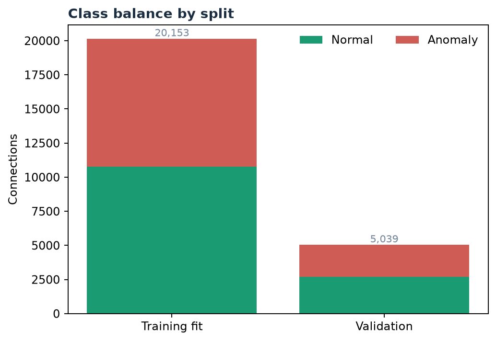
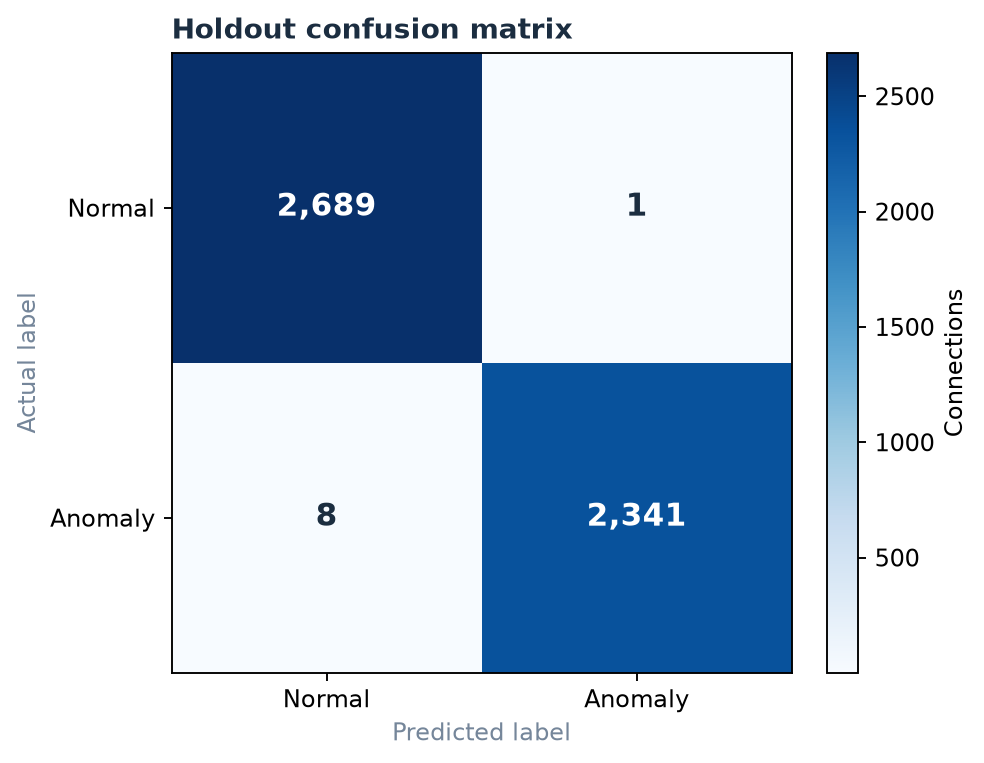
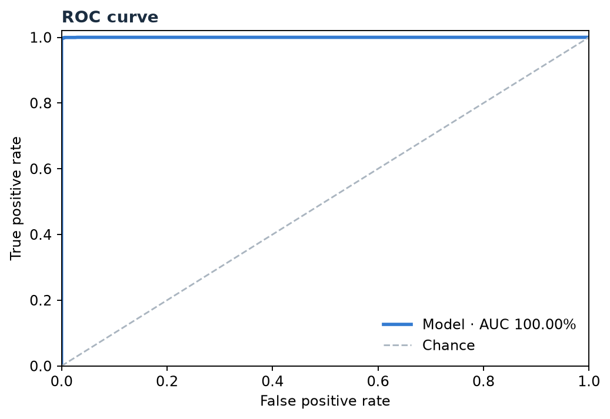
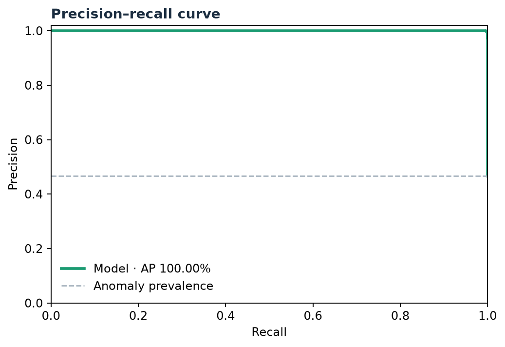
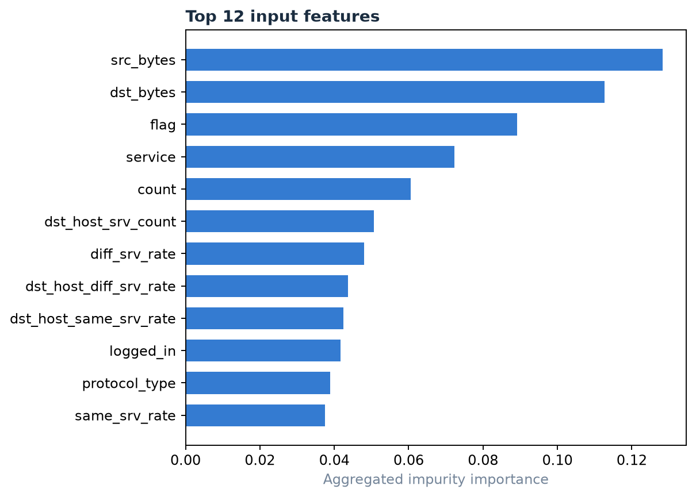

# Network Intrusion Detection — Model Report

Generated from the model metadata on **2026-10-27 14:33 UTC**. The interactive charts are available in the local app at [Model Insights](http://127.0.0.1:5000/insights) while the app is running.

## At a glance

| Item | Value |
|---|---:|
| Model | Random Forest Classifier |
| Target | `class` (`anomaly` is the positive class) |
| Labeled training rows | 25,192 |
| Training fit rows | 20,153 |
| Holdout validation rows | 5,039 |
| Input features used | 40 |
| Holdout accuracy | **99.82%** |
| ROC-AUC | **100.00%** |
| Average precision | **100.00%** |

This is a stratified random holdout from the supplied labeled training CSV. `Test_data.csv` has no labels and is used only as an unlabeled prediction sample.

## Dataset and split

The source file is `data/Train_data.csv`. It contains 25,192 labeled connections: 13,449 normal and 11,743 anomaly. The split uses `train_test_split(test_size=0.2, stratify=class, random_state=42)`, producing 20,153 fit rows and 5,039 validation rows. Class stratification preserves the approximate class proportions in each split.

The model uses these 40 input columns (the constant `num_outbound_cmds` column is excluded):

`duration`, `protocol_type`, `service`, `flag`, `src_bytes`, `dst_bytes`, `land`, `wrong_fragment`, `urgent`, `hot`, `num_failed_logins`, `logged_in`, `num_compromised`, `root_shell`, `su_attempted`, `num_root`, `num_file_creations`, `num_shells`, `num_access_files`, `is_host_login`, `is_guest_login`, `count`, `srv_count`, `serror_rate`, `srv_serror_rate`, `rerror_rate`, `srv_rerror_rate`, `same_srv_rate`, `diff_srv_rate`, `srv_diff_host_rate`, `dst_host_count`, `dst_host_srv_count`, `dst_host_same_srv_rate`, `dst_host_diff_srv_rate`, `dst_host_same_src_port_rate`, `dst_host_srv_diff_host_rate`, `dst_host_serror_rate`, `dst_host_srv_serror_rate`, `dst_host_rerror_rate`, `dst_host_srv_rerror_rate`

### Split class balance

## Preprocessing and classifier

- Categorical columns: `protocol_type, service, flag`. Missing values are filled with the most frequent training value, then one-hot encoded. Categories not seen during training are ignored by the encoder rather than causing prediction to fail.
- Numeric columns: 37 numeric features. Missing values are filled with the median learned from the fit partition.
- Classifier: Random Forest with 220 trees, `max_features=sqrt`, `max_depth=None`, `min_samples_leaf=1`, `class_weight=balanced_subsample`, and `random_state=42`.
- Evaluation: metrics and curves are measured on the held-out 20% before the deployable pipeline is refit using all labeled rows.
- Implementation: scikit-learn 1.9.1 pipeline; curve samples are stored with the local model metadata.

## Holdout evaluation

| Metric | Result | Meaning |
|---|---:|---|
| Accuracy | 99.82% | Share of all connections classified correctly |
| Precision (anomaly) | 99.96% | Share of predicted anomalies that are actual anomalies |
| Recall / sensitivity (anomaly) | 99.66% | Share of actual anomalies detected |
| Specificity (normal) | 99.96% | Share of actual normal connections correctly recognized |
| F1 (anomaly) | 99.81% | Harmonic mean of anomaly precision and recall |
| False-positive rate | 0.04% | Share of normal connections incorrectly flagged as anomalies |
| ROC-AUC | 100.00% | Threshold-independent ranking across true-positive and false-positive rates |
| Average precision | 100.00% | Area-style summary of the precision–recall curve, weighted across recall increments |

### Confusion matrix

Rows are actual classes; columns are predicted classes.

| Actual \ Predicted | Normal | Anomaly |
|---|---:|---:|
| Normal | TN = 2,689 | FP = 1 |
| Anomaly | FN = 8 | TP = 2,341 |

### ROC and precision–recall curves

## Metric definitions and formulas

For anomaly as the positive class: **TP** is an anomaly correctly flagged; **TN** is normal traffic correctly cleared; **FP** is normal traffic incorrectly flagged; **FN** is an anomaly missed by the model.

| Term | Formula | Interpretation |
|---|---|---|
| Accuracy | `(TP + TN) / (TP + TN + FP + FN)` | Overall fraction of correct predictions. |
| Precision | `TP / (TP + FP)` | Of all connections flagged as anomalies, how many are anomalies. |
| Recall / sensitivity | `TP / (TP + FN)` | Of all actual anomalies, how many the model detects. |
| Specificity | `TN / (TN + FP)` | Of all actual normal connections, how many the model clears. |
| F1 score | `2 × Precision × Recall / (Precision + Recall)` | Harmonic mean that balances precision and recall. |
| False-positive rate | `FP / (FP + TN)` | Fraction of normal connections incorrectly flagged; equals `1 − Specificity`. |
| ROC curve | Plot `TPR = TP/(TP+FN)` against `FPR = FP/(FP+TN)` over score thresholds. | Shows the detection and false-alarm tradeoff as the threshold changes. |
| ROC-AUC | `∫ TPR d(FPR)` | Probability-style ranking summary; 1 is perfect ranking and 0.5 is chance-level ranking. |
| Precision–recall curve | Plot `Precision = TP/(TP+FP)` against `Recall = TP/(TP+FN)` over score thresholds. | Focuses on anomaly detection quality, especially when class frequencies differ. |
| Average precision | `Σ (Recallₙ − Recallₙ₋₁) × Precisionₙ` | Summarizes precision over recall increments; higher values are better. |

Precision, recall, specificity, and F1 use the model's default class decision. ROC-AUC and average precision use the predicted anomaly probabilities across thresholds.

## Feature importance

The chart aggregates the Random Forest's impurity-based importance across one-hot columns back to each original input feature. These values describe how often and how effectively the fitted trees use a feature to reduce node impurity; they are not causal explanations and can favor features with many possible values.

| Rank | Input feature | Aggregated importance |
|---:|---|---:|
| 1 | `src_bytes` | 0.128286 |
| 2 | `dst_bytes` | 0.112749 |
| 3 | `flag` | 0.089107 |
| 4 | `service` | 0.072277 |
| 5 | `count` | 0.060480 |
| 6 | `dst_host_srv_count` | 0.050692 |
| 7 | `diff_srv_rate` | 0.047964 |
| 8 | `dst_host_diff_srv_rate` | 0.043766 |
| 9 | `dst_host_same_srv_rate` | 0.042456 |
| 10 | `logged_in` | 0.041660 |
| 11 | `protocol_type` | 0.038847 |
| 12 | `same_srv_rate` | 0.037496 |
| 13 | `dst_host_serror_rate` | 0.027858 |
| 14 | `dst_host_same_src_port_rate` | 0.023987 |
| 15 | `dst_host_srv_diff_host_rate` | 0.022953 |

The local app's [Model Insights page](http://127.0.0.1:5000/insights) includes interactive versions of these charts with hover values and zoom controls.

## Limitations

- The holdout is randomly drawn from the supplied training CSV. It is not a time-based or independently collected network test, so the score may be optimistic for different networks or future traffic.
- The supplied test CSV has no ground-truth class labels; no accuracy claim is made for its predictions.
- Feature importance is a model diagnostic, not a causal explanation for an individual prediction.
- Accuracy can hide class-specific errors. Review precision, recall, specificity, false-positive rate, and the confusion matrix together when assessing the operating tradeoff.
